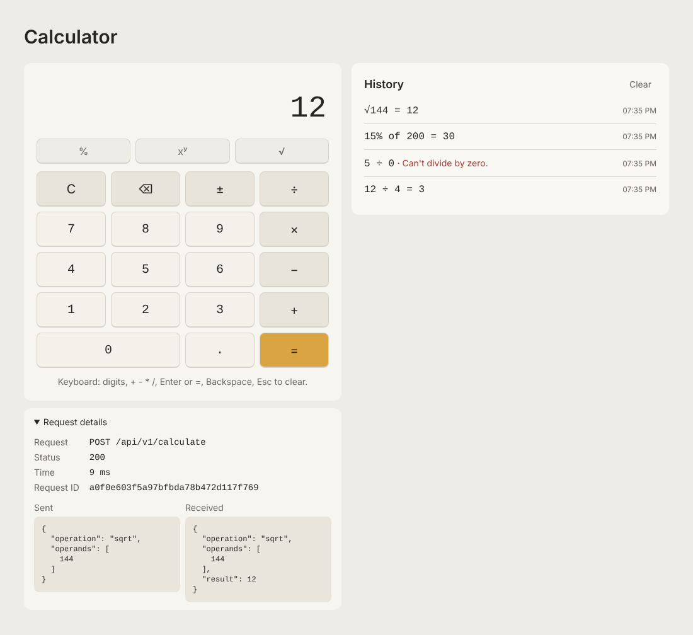

# Full-Stack Calculator

[](https://github.com/gonzalolavin99/sezzle-fullstack-calculator/actions/workflows/ci.yml)

A calculator with a React + TypeScript frontend and a Go backend service. Every calculation goes through the REST
API; the browser never does the math. Built as a take-home assignment.



**Highlights**
- Go standard library only (no web framework), in three layers: domain, use case, HTTP adapter.
- Seven operations behind one `POST /api/v1/calculate` endpoint, with typed errors and stable error codes.
- The UI builds its advanced keys from `GET /api/v1/operations`, so a new backend operation appears without UI changes.
- Keyboard support, screen reader announcements, AA contrast, 360px to desktop, light and dark mode.
- One command to run everything (`docker compose up --build`); CI runs lint, race-detector tests, coverage and an
  end-to-end browser test on every pull request.

## Prerequisites

Only Docker is needed to run the full stack. To run or develop each layer locally:

| Tool | Version used | Needed for |
|---|---|---|
| Go | 1.27.0 | backend |
| Node.js | 24 LTS (24.20.0) | frontend |
| Docker | Engine 29.8.2 (Docker Desktop 4.95.0) | full stack with `docker compose` |
| GNU Make | 4.4.1 | shortcuts in the `Makefile` (optional) |
| golangci-lint | 2.15.0 | backend lint and format; install with `make tools` |

`make tools` installs into the Go bin directory (`go env GOPATH` + `/bin`); make sure it is on your `PATH`.

`make help` lists every shortcut (`dev`, `test`, `coverage`, `lint`, `fmt`, `docker-up`, ...). The `Makefile`
only uses commands that work in both POSIX `sh` and Windows `cmd.exe`.

## Quick start

```bash
docker compose up --build      # or: make docker-up
```

Open `http://localhost:8080`. nginx serves the app and forwards `/api` to the Go service, which is not published
on the host; the API is reachable through nginx, for example `curl -X POST http://localhost:8080/api/v1/calculate
-d '{"operation":"divide","operands":[10,4]}'`. The frontend starts once the backend's healthcheck passes.
Stop with `Ctrl+C`, or `docker compose down` (`make docker-down`) when started with `-d`.

## Running without Docker

### Backend

```bash
make dev-backend          # or: cd backend && go run ./cmd/server
```

The API listens on `http://localhost:8080`. Configuration comes from environment variables:

| Variable | Default | Meaning |
|---|---|---|
| `PORT` | `8080` | TCP port to listen on |
| `ALLOWED_ORIGINS` | `http://localhost:5173` | Comma-separated browser origins allowed by CORS; only needed when the frontend runs on another origin (live demo, or Vite without its proxy) |
| `LOG_LEVEL` | `info` | `debug`, `info`, `warn` or `error`; logs are JSON lines on stdout |

Invalid values stop the server at startup with a clear message. `Ctrl+C` or `SIGTERM` shuts it down gracefully,
giving in-flight requests up to 10 seconds to finish.

### Frontend

```bash
cd frontend && npm install    # once
make dev-frontend             # or: cd frontend && npm run dev
```

Vite serves the app on `http://localhost:5173`. Other scripts: `npm test`, `npm run coverage`, `npm run lint`
(ESLint, Prettier check and strict `tsc`), `npm run format`, `npm run build`.

> On Windows PowerShell with script execution disabled, call `npm.cmd` instead of `npm`. `make` is not affected.

## Tests and coverage

| Layer | Tests | Coverage (statements) |
|---|---|---|
| Backend (Go) | table-driven unit tests per layer, HTTP tests with `httptest`, OpenAPI sync test; run with `-race` in CI | 96.4% (domain and use case 100%) |
| Frontend | 146 Vitest tests: API client (MSW), reducer, components, user flows | 98.8% |
| End to end | Playwright against the Docker Compose stack | 2 smoke tests |

CI uploads both coverage reports (HTML) as artifacts of every run (Actions → a run → *Artifacts*).

```bash
make test-backend       # go test ./...
make coverage-backend   # per-function report, plus backend/coverage.html
make test-race          # race detector in a Linux container (it needs cgo, so it does not run natively on Windows)
make lint-backend       # golangci-lint run + format check

make test-frontend      # Vitest: API client, reducer, components and user flows (MSW fakes the backend)
make coverage-frontend  # text summary, plus frontend/coverage/index.html
make lint-frontend      # ESLint, Prettier check and strict tsc

# End-to-end smoke test (Playwright) against the full stack
docker compose up --build -d --wait
make e2e-install        # once: Chromium and the system libraries it needs
make e2e                # opens the app, computes 12 ÷ 4 = 3, checks the 5 ÷ 0 error
docker compose down
```

## API reference

Base path `/api/v1`, JSON in and out. The full contract is in [`backend/api/openapi.yaml`](backend/api/openapi.yaml)
(OpenAPI 3.1); a test fails if a route or error code used by the code is missing from it. The examples below were
run against `docker compose up` (through nginx on port 8080; `make dev-backend` listens on the same port).

| Method | Path | Purpose |
|---|---|---|
| `POST` | `/api/v1/calculate` | Run one operation |
| `GET` | `/api/v1/operations` | List the operations and how many operands each takes |
| `GET` | `/healthz` | Liveness (used by the Docker healthcheck; served by the backend itself, not proxied by nginx) |

Every response carries an `X-Request-ID` header that also appears in the backend's log line for that request.

### Success

```bash
curl -X POST http://localhost:8080/api/v1/calculate \
  -H 'Content-Type: application/json' \
  -d '{"operation":"divide","operands":[10,4]}'
```
```json
{"operation":"divide","operands":[10,4],"result":2.5}
```

```bash
curl http://localhost:8080/api/v1/operations
```
```json
{"operations":[{"name":"add","arity":2},{"name":"divide","arity":2},{"name":"multiply","arity":2},{"name":"percentage","arity":2},{"name":"power","arity":2},{"name":"sqrt","arity":1},{"name":"subtract","arity":2}]}
```

Operations: `add`, `subtract`, `multiply`, `divide`, `power` (aᵇ), `sqrt` (one operand), `percentage`
(`[15, 200]` → 30, "15% of 200").

### Errors

All errors have the same shape, `{"error":{"code":"...","message":"..."}}`. `400` means the request itself is wrong;
`422` means the request is well formed but the math is not defined for those numbers.

| Request body (`POST /api/v1/calculate`) | Status | Response |
|---|---|---|
| `{"operation":"divide","operands":[5,0]}` | 422 | `{"error":{"code":"DIVISION_BY_ZERO","message":"divide: cannot divide by zero"}}` |
| `{"operation":"sqrt","operands":[-9]}` | 422 | `{"error":{"code":"INVALID_OPERAND","message":"sqrt: operation is undefined for these operands"}}` |
| `{"operation":"power","operands":[10,400]}` | 422 | `{"error":{"code":"RESULT_OUT_OF_RANGE","message":"power: result is out of range"}}` |
| `{"operation":"modulo","operands":[5,2]}` | 400 | `{"error":{"code":"UNKNOWN_OPERATION","message":"unknown operation: \"modulo\""}}` |
| `{"operation":"add","operands":[1]}` | 400 | `{"error":{"code":"INVALID_ARITY","message":"add: wrong number of operands: expects 2, got 1"}}` |
| `{"operation":` (broken JSON) | 400 | `{"error":{"code":"INVALID_REQUEST","message":"request body must be valid JSON"}}` |

Other codes: `INVALID_REQUEST` also covers a missing field, unknown fields and bodies over 64 KiB; `INVALID_OPERAND`
with 400 covers an operand that is `null`, not a number, or too large for a `float64` (such as `1e400`);
`METHOD_NOT_ALLOWED` (405, with an `Allow` header), `NOT_FOUND` (404) and `INTERNAL_ERROR` (500, no internals in the
message).

## Architecture

```
Browser ──► nginx (:8080) ──/api──► Go service
            serves the React app     httpapi (handlers, JSON, errors → status, middleware)
                                       └► app (calculate use case)
                                            └► calculator (domain: operations, registry, errors)
```

**Backend** ([ADR 0002](docs/adr/0002-hexagonal-lite-architecture.md)): one Go service in three layers, with
dependencies pointing inward.
- `internal/calculator`: the domain. Each operation is a small type with `Name()`, `Arity()` and `Apply()`, kept in a
  registry. No HTTP, JSON or logging. Errors are typed values (`ErrDivisionByZero`, ...), and one shared guard rejects
  any `NaN` or infinite result, so no operation can return one.
- `internal/app`: the calculate use case (look up the operation, run it).
- `internal/adapters/httpapi`: handlers, request validation, the error-to-status mapping, and middleware (request ID,
  structured `slog` logs, panic recovery, CORS for a different-origin deployment).
- `cmd/server`: configuration from environment variables, timeouts, graceful shutdown.

**Frontend**: React + TypeScript (strict), Vite, Tailwind.
- `src/api/`: a typed client (`fetch` with a timeout, runtime checks on the response shape, a friendly message for
  every error code; a new code without a message does not compile).
- `src/features/calculator/reducer.ts`: the calculator as a pure state machine. Pressing `=` produces a *pending
  request*; a hook sends it and feeds the answer back. Late answers are ignored by request ID.
- Components: `Display`, `Keypad`, `AdvancedOperations` (built from the API), `ErrorBanner`, `Tape` ("History"),
  `ApiInspector` ("Request details").

### Adding an operation

1. Backend: add a type in `backend/internal/calculator` (for example in `advanced.go`) with `Name`, `Arity` and
   `Apply`, using the shared `checkOperands` and `checkResult` helpers; add a table-driven test; add one line to
   `DefaultOperations()` in `defaults.go`.
2. That is enough for it to work end to end: `GET /api/v1/operations` lists it and the UI shows a key with its API
   name. Optionally give it a symbol and an accessible name in `frontend/src/features/calculator/labels.ts`, and a
   readable expression in `format.ts`.

## Design decisions and trade-offs

| Decision | Why | Alternative not chosen |
|---|---|---|
| Go standard library, no framework ([ADR 0001](docs/adr/0001-monorepo-and-stack.md)) | Method-aware routing is built in since Go 1.22; three routes do not need Gin or Echo | Gin/Echo: more dependencies for no gain here |
| Hexagonal-lite, one service ([ADR 0002](docs/adr/0002-hexagonal-lite-architecture.md)) | The math is testable without a server; new transports or operations do not touch other layers | Several microservices: network calls and deployment cost for a calculator |
| One `calculate` endpoint with an `operation` field ([ADR 0003](docs/adr/0003-api-design.md)) | One handler and one validation path; the registry decides what exists | `/add`, `/divide`, ...: repeated handlers |
| 400 vs 422 | Separates "your request is wrong" from "the math is undefined" | 400 for everything: loses that information |
| `float64` end to end ([ADR 0004](docs/adr/0004-numeric-precision.md)) | Matches JSON numbers; simple and documented | A decimal library: right for money, more than a calculator needs |
| All math in the backend | The brief asks for an API-driven calculator; one source of truth | Computing in the browser: faster, but the API would be decorative |
| Pure reducer + hook in the frontend | Every key press is a tested state transition, no React needed to test it | State spread across components |
| Tailwind with design tokens ([ADR 0005](docs/adr/0005-styling-and-deployment.md)) | Light/dark mode by swapping CSS variables; styles next to components | CSS modules |
| nginx proxies `/api` | Same origin in production (and Vite's proxy in development), so no CORS | Calling the backend's port directly from the browser |

## Assumptions

- **Percentage** is "a % of b": `percentage(15, 200) = 30`. It multiplies first (`a × b ÷ 100`) so common results are
  exact, and only divides first if `a × b` would overflow.
- **Numbers are `float64`.** The API returns raw results, so `0.1 + 0.2` returns `0.30000000000000004`; the UI rounds
  for display only (15 significant digits, or scientific notation for very large or small values), so it shows `0.3`.
  For money, a payments system would use integer minor units (cents) or a decimal type instead.
- **Inputs:** `NaN` and infinite operands are rejected; a result that overflows is `RESULT_OUT_OF_RANGE`; `-0` is
  returned as `0`. The keypad accepts up to 15 digits, which `float64` represents exactly.
- **Power:** a negative base with a fractional exponent is `INVALID_OPERAND`; zero to a negative power is
  `DIVISION_BY_ZERO`.
- **Chaining** works left to right like a desk calculator: `2 + 3 × 4 =` is `20`, not `14`. Each step is one API call.

## AI usage

I used Claude Code throughout, as a pair programmer and teacher (I had not written Go before this project). The
working rules it followed are in [`CLAUDE.md`](CLAUDE.md): tests first, explain each step, ask before new
dependencies or contract changes, and log every meaningful prompt. The log, with what was produced, what I checked and
the mistakes that were caught, is in [`docs/ai/PROMPTS.md`](docs/ai/PROMPTS.md). An independent `code-reviewer`
subagent ([`.claude/agents/code-reviewer.md`](.claude/agents/code-reviewer.md)) reviewed each phase before its pull
request, and its findings and fixes are in the log too. The visual draft came from v0 and was rebuilt by hand
([`docs/DESIGN.md`](docs/DESIGN.md)).

## What I would do with more time

- **Expression mode** (`(2 + 3) × 4`) with a small parser in the domain, instead of left-to-right chaining.
- **`/metrics`** with Prometheus counters and a latency histogram per operation.
- **Rate limiting** middleware (token bucket) on `/api`.
- **Frontend polish:** a "retry" link when the operations list fails to load; announce a repeated identical result
  again; keep keyboard focus after dismissing an error; keep keys typed faster than the backend answers instead of
  dropping them while a request is pending.
- **Deployment:** the optional live demo described in ADR 0005, and an unprivileged nginx image.

## Time spent

## License

MIT, see [LICENSE](LICENSE).
